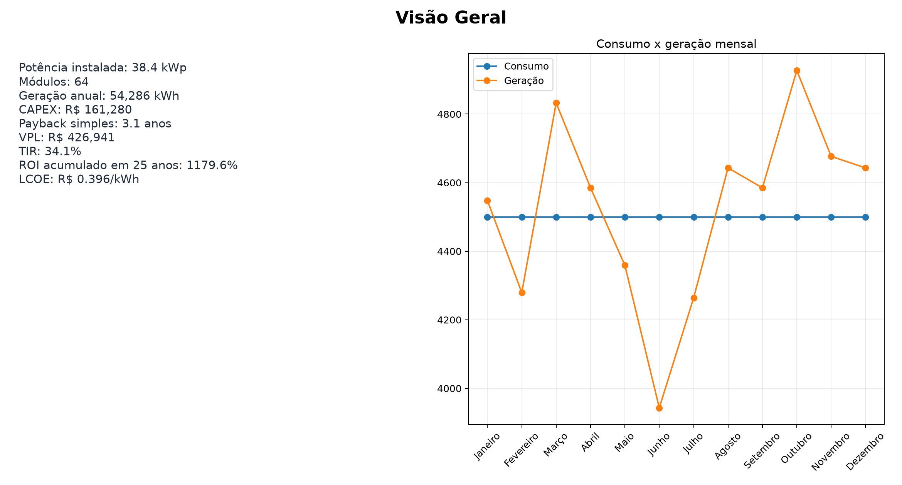
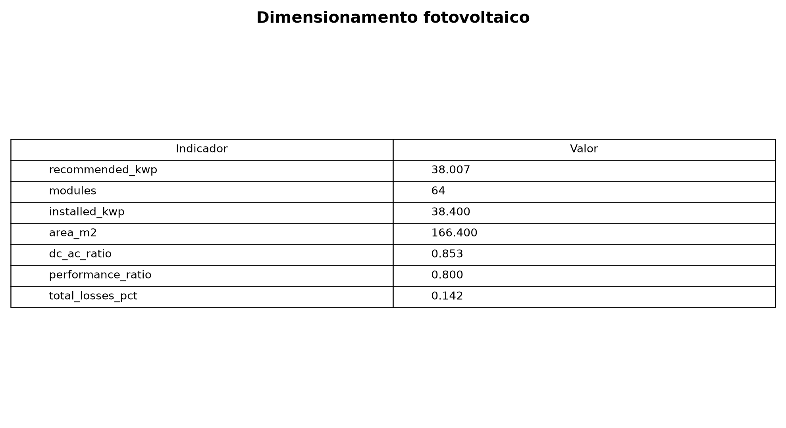
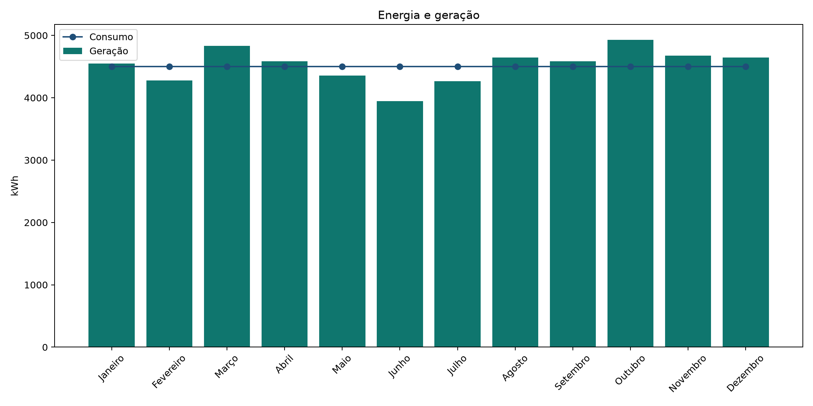
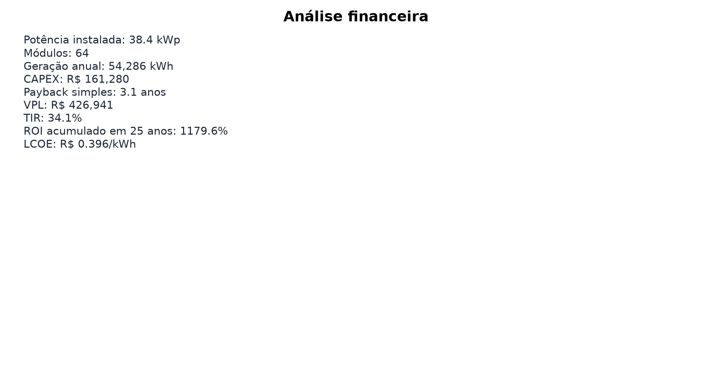

# Simulador de Viabilidade Técnico-Econômica Solar FV
### *Solar Energy Techno-Economic Feasibility Simulator*

[](https://luscaarmstrong1.github.io/solar-energy-feasibility-simulator/)
[](https://lucas-santos-portfolio-zeta.vercel.app/)
[](https://www.linkedin.com/in/lucasssantos1/)
[](https://github.com/luscaarmstrong1/solar-energy-feasibility-simulator)

> **Camada 04 • Ecossistema de Engenharia, Energia, Dados & Automação**
> Dimensionamento energético por HSP e Performance Ratio, projeção de fluxo de caixa descontado em 25 anos, cálculo de VPL, TIR, Payback e LCOE.

---

## Acesse o Simulador Interativo e Demonstração Online

- **Simulador Paramétrico Web (GitHub Pages):** [https://luscaarmstrong1.github.io/solar-energy-feasibility-simulator/](https://luscaarmstrong1.github.io/solar-energy-feasibility-simulator/)
- **Vitrine no Portfólio Principal:** [https://lucas-santos-portfolio-zeta.vercel.app/#arquitetura](https://lucas-santos-portfolio-zeta.vercel.app/#arquitetura)

---

## Visão Geral e Problema de Engenharia

Simulador técnico-econômico de usinas e sistemas fotovoltaicos em horizonte de 25 anos: dimensionamento por HSP/PR, degradação anual, fluxo de caixa descontado, VPL, TIR, payback e LCOE em Python, Streamlit e Excel.

### Indicadores-Chave do Projeto (Caso-Base)

| Indicador Técnico | Resultado / Escopo | Detalhamento de Engenharia |
| :--- | :--- | :--- |
| **Potência Caso-Base** | `38,4 kWp` | 64 módulos de 600 Wp |
| **Geração Anual** | `54.286 kWh` | Degradação linear 0,5%/ano |
| **VPL (25 Anos)** | `R$ 426.941` | TIR de 34,1% a.a. |
| **Payback & LCOE** | `3,1 anos` | LCOE de R$ 0,396/kWh |

---

## Arquitetura do Sistema e Fluxo de Modelagem

1. **Etapa 01:** Entrada de Premissas Técnicas e Tarifárias (Consumo mensal, HSP local, PR, tarifa e inflação energética)
2. **Etapa 02:** Motor de Engenharia Fotovoltaica (Cálculo de potência kWp, número de módulos, inversor e geração com degradação)
3. **Etapa 03:** Modelagem Econômico-Financeira de 25 Anos (CAPEX, OPEX, fluxo de caixa livre e descontado, VPL, TIR e LCOE)
4. **Etapa 04:** Análise de Sensibilidade Bivariada (Matriz CAPEX × Tarifa e cenários Conservador, Base e Otimista)

---

## Fundamentação Física, Matemática e Regulatória

### 1. Dimensionamento da Potência de Pico (kWp)
```text
P_FV = Consumo_Diário(kWh) / (HSP_média · PR)
```

### 2. Valor Presente Líquido em 25 Anos (VPL)
```text
VPL = -CAPEX_0 + Σ_{t=1..25} [Fluxo_Caixa_Líquido(t) / (1 + TMA)^t]
```

### 3. Custo Nivelado de Energia (LCOE)
```text
LCOE = [CAPEX_0 + Σ (OPEX_t / (1+r)^t)] / [Σ (E_gerada,t · (1-d)^(t-1) / (1+r)^t)]
```

---

## Painéis Analíticos e Evidências Visuais

### Painel Executivo de Viabilidade Técnica e Econômica


### Dimensionamento Físico do Sistema Fotovoltaico


### Balanço Mensal de Geração e Degradação em 25 Anos


### Indicadores Financeiros: VPL, TIR, ROI e LCOE


---

## Como Executar Localmente

```bash
# 1. Clone o repositório
git clone https://github.com/luscaarmstrong1/solar-energy-feasibility-simulator.git
cd solar-energy-feasibility-simulator

# 2. Instale as dependências e execute a suíte analítica
pip install -r requirements.txt
python scripts/finalizar_projeto.py
pytest
streamlit run app.py
```

> **Nota Técnica:** Este projeto utiliza modelagem determinística auditável e séries sintéticas estruturadas para demonstração de arquitetura de engenharia elétrica, ciência de dados e tomada de decisão técnico-econômica. Não substitui projeto executivo, parecer de acesso da concessionária ou emissão de ART específica de campo.

---

## Autor e Responsável Técnico

**Lucas Silva Santos**
*Engenheiro Eletricista & Gerente de Projetos*
Energia • Dados • Inteligência Artificial • Automação • São João da Boa Vista, SP • Itajubá, MG

- **Portfólio:** [https://lucas-santos-portfolio-zeta.vercel.app/](https://lucas-santos-portfolio-zeta.vercel.app/)
- **LinkedIn:** [linkedin.com/in/lucasssantos1](https://www.linkedin.com/in/lucasssantos1/)
- **GitHub:** [@luscaarmstrong1](https://github.com/luscaarmstrong1)
