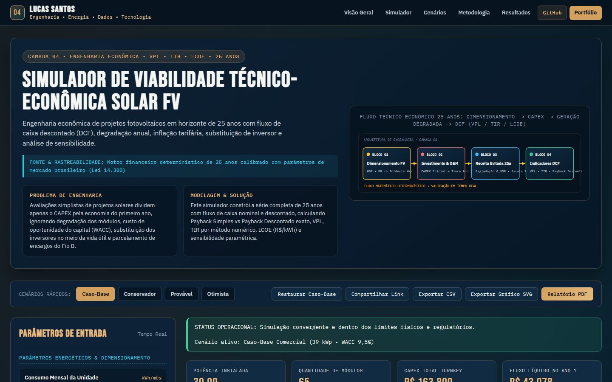

# Simulador de Viabilidade Técnico-Econômica Solar FV

> **Camada 04 do Ecossistema de Engenharia Interativa V3 • Engenharia Econômica • VPL • TIR • LCOE • 25 Anos**  
> Engenharia econômica de projetos fotovoltaicos em horizonte de 25 anos com fluxo de caixa descontado (DCF), degradação anual, inflação tarifária, substituição de inversor e análise de sensibilidade.

[](https://luscaarmstrong1.github.io/solar-energy-feasibility-simulator/)
[](https://github.com/luscaarmstrong1/solar-energy-feasibility-simulator)
[](https://luscaarmstrong1.github.io/solar-energy-feasibility-simulator/)
[](https://lucassantos.eng.br/#arquitetura)
[](https://github.com/luscaarmstrong1/solar-energy-feasibility-simulator)

---

## 1. Resumo Executivo

Este repositório integra o ecossistema de **Engenharia Interativa V3** de **Lucas Santos**, combinando modelagem física e técnico-econômica em Python com um **Simulador Web Interativo publicado no GitHub Pages** ([https://luscaarmstrong1.github.io/solar-energy-feasibility-simulator/](https://luscaarmstrong1.github.io/solar-energy-feasibility-simulator/)).

- **Rastreabilidade dos Dados e Modelo:** Motor financeiro determinístico de 25 anos calibrado com parâmetros de mercado brasileiro (Lei 14.300).
- **Aplicação Web Autônoma:** Executa integralmente no navegador sem dependências externas frágeis, com validação de fronteira, comparador multicenário e exportação técnica (CSV, SVG e Relatório PDF).

---

## 2. Problema de Engenharia Abordado

Avaliações simplistas de projetos solares dividem apenas o CAPEX pela economia do primeiro ano, ignorando degradação dos módulos, custo de oportunidade do capital (WACC), substituição dos inversores no meio da vida útil e parcelamento de encargos do Fio B.

---

## 3. Solução Proposta

Este simulador constrói a série completa de 25 anos com fluxo de caixa nominal e descontado, calculando Payback Simples vs Payback Descontado exato, VPL, TIR por método numérico, LCOE (R$/kWh) e sensibilidade paramétrica.

---

## 4. Funcionalidades Principais da Aplicação Interativa (V3)

1. **Painel Paramétrico Sincronizado (Slider + Input Numérico):** Controles duplos bidirecionais agrupados por domínio físico, operacional e econômico, com validação contra valores inválidos (`NaN`, `Infinity` ou fora de faixa).
2. **Motor Matemático Determinístico Auditado:** Recálculo instantâneo de todos os indicadores-chave (KPIs), balanços energéticos e séries temporais/financeiras.
3. **Múltiplas Visualizações Gráficas em Alta Nitidez (SVG):** Abas dedicadas com gráficos vetoriais responsivos e tooltips informativos.
4. **Comparador Multicenário Lado a Lado:** Comparação simultânea entre **Caso-Base**, **Conservador**, **Provável**, **Otimista** e a **Simulação Atual** do usuário.
5. **Diagnóstico Técnico Automatizado:** Geração dinâmica de alertas operacionais e recomendações de engenharia conforme os parâmetros configurados.
6. **Exportação e Compartilhamento:**
   - **Compartilhar Link:** Codifica todos os parâmetros na URL (`?param=valor`) para reprodutibilidade exata.
   - **Exportar CSV:** Download imediato da tabela de memória de cálculo.
   - **Exportar Gráfico SVG:** Download vetorial do gráfico ativo.
   - **Relatório PDF:** Folha de estilo dedicada para impressão técnica.

---

## 5. Demonstração Visual (Captura Real V3)



- **Acesse o Simulador Interativo:** [https://luscaarmstrong1.github.io/solar-energy-feasibility-simulator/](https://luscaarmstrong1.github.io/solar-energy-feasibility-simulator/)
- **Voltar à Seção #arquitetura no Portfólio:** [https://lucassantos.eng.br/#arquitetura](https://lucassantos.eng.br/#arquitetura)

---

## 6. Arquitetura Técnica e Fluxo de Dados

```text
[Parâmetros do Usuário / Presets de Cenário]
                 │
                 ▼
[Validação de Fronteira & Normalização Física]
                 │
                 ▼
[Motor Matemático Determinístico (Python & JS Engine V3)]
                 │
     ┌───────────┼───────────┐
     ▼           ▼           ▼
[KPI Cards] [Gráficos SVG] [Matriz Multicenário & Exportação CSV/PDF]
```

---

## 7. Metodologia e Equações Governantes

### 9.1. Geração Anual com Degradação Linear Composta

```text
E_t = P_kWp * HSP * PR * 365 * (1 - d)^(t - 1)   para t = 1..25
```

Contabiliza o envelhecimento natural das células fotovoltaicas ao longo de 25 anos.

### 9.2. Valor Presente Líquido (VPL) e Taxa Interna de Retorno (TIR)

```text
VPL = -CAPEX + Σ_{t=1}^{25} [ (E_t * Tarifa_t * f_comp - OPEX_t - Inv_12) / (1 + WACC)^t ]
```

Inclui provisão de retrofit dos inversores no ano 12 (12% do CAPEX). A TIR é a raiz r* que anula o VPL.

### 9.3. Custo Nivelado de Energia (LCOE)

```text
LCOE = [ CAPEX + Σ (OPEX_t + Inv_t)/(1 + WACC)^t ] / [ Σ E_t / (1 + WACC)^t ]
```

Expressa em R$/kWh o custo real de produzir cada quilowatt-hora ao longo de toda a vida útil da usina.

---

## 8. Premissas e Limitações do Modelo

- **Escopo Analítico:** Os resultados constituem estudos preliminares de engenharia e viabilidade técnico-econômica. Projetos executivos requerem medições locais de campanha, estudos de curto-circuito/coordenação de proteção e parecer formal da concessionária ou ONS/CCEE.
- **Conservação Física:** Nenhuma eficiência excede 100%, nenhum despacho de bateria viola `[SOC_min, SOC_max]` e todas as séries respeitam limites físicos estritos.

---

## 9. Parâmetros de Entrada e Faixas Aceitas

| Parâmetro | Unidade | Faixa Permitida | Valor Padrão | Descrição Técnica |
|---|---|---|---|---|
| **Consumo Mensal da Unidade** (`consumoMensalKwh`) | kWh/mês | [300 a 150000] | `4500` | Demanda energética mensal média a ser compensada. |
| **Irradiação Local (HSP)** (`hsp`) | kWh/m²/dia | [3.2 a 6.8] | `4.85` | Média anual de Horas de Sol Pleno da localidade. |
| **Taxa de Desempenho (PR)** (`prPct`) | % | [65 a 90] | `80` | Rendimento global considerando perdas térmicas, cabos e inversor. |
| **Potência Unitária do Módulo** (`modWp`) | Wp | [400 a 720] | `600` | Potência STC de cada módulo fotovoltaico. |
| **CAPEX Específico Instalado** (`custoKwp`) | R$/kWp | [2600 a 7500] | `4200` | Custo total turnkey por kWp instalado (equipamentos + engenharia + obra). |
| **Tarifa de Energia Vigente** (`tarifaKwh`) | R$/kWh | [0.45 a 2.2] | `0.92` | Tarifa plena com impostos da concessionária local. |
| **Reajuste Tarifário Anual (g)** (`inflacaoTarifaPct`) | % a.a. | [0 a 15] | `6` | Taxa anual esperada de reajuste da tarifa elétrica. |
| **Fração Tarifária Compensável** (`fioBCompensadoPct`) | % | [60 a 100] | `88` | Percentual efetivo do valor da tarifa abatido após regra do Fio B / autoconsumo simultâneo. |
| **Degradação Anual dos Módulos (d)** (`degradacaoPct`) | % a.a. | [0.2 a 1.5] | `0.55` | Perda anual linear de eficiência das células fotovoltaicas. |
| **O&M Anual (% do CAPEX)** (`omAnualPct`) | % a.a. | [0.3 a 3.5] | `1` | Custo anual de limpeza, inspeção termográfica e seguro. |
| **Taxa Mínima de Atratividade / WACC** (`waccPct`) | % a.a. | [4 a 22] | `9.5` | Taxa de desconto anual para cálculo do VPL, Payback Descontado e LCOE. |

---

## 10. Indicadores de Saída (KPIs Explicados)

| Indicador (KPI) | Unidade | Interpretação de Engenharia |
|---|---|---|
| **Potência Instalada** (`installedKwp`) | kWp | Sistema dimensionado para a carga |
| **Quantidade de Módulos** (`nModules`) | módulos | Arranjo físico necessário |
| **CAPEX Total Turnkey** (`capexBrl`) | R$ | Investimento inicial no Ano 0 |
| **Fluxo Líquido no Ano 1** (`year1SavingsBrl`) | R$/ano | Economia líquida já descontando O&M |
| **Payback Simples** (`simplePaybackYrs`) | anos | Retorno nominal sem desconto |
| **Payback Descontado (WACC)** (`discountedPaybackYrs`) | anos | Retorno real descontado pelo custo de capital |
| **VPL (25 Anos)** (`npvBrl`) | R$ | Riqueza líquida gerada em valor presente |
| **Taxa Interna de Retorno (TIR)** (`irrPct`) | % a.a. | Rentabilidade anualizada do fluxo |
| **LCOE Fotovoltaico** (`lcoeBrlKwh`) | R$/kWh | Custo nivelado da geração própria |

---

## 11. Estrutura de Diretórios do Repositório

```text
solar-energy-feasibility-simulator/
├── docs/                       # Aplicação Web Interativa V3 (GitHub Pages)
│   ├── index.html              # Interface completa com esquemático SVG e seções técnicas
│   ├── simulator.css           # Design System Dark Technical Navy + Copper Gold V3
│   ├── simulator.js            # Motor matemático JS auditado + renderizador gráfico SVG
│   └── assets/
│       └── v3-preview.png      # Captura real da interface V3 em 1440x900
├── src/                        # Módulos Python de engenharia, simulação e pipeline de dados
├── data/                       # Datasets de referência, séries curadas e saídas analíticas
├── tests/                      # Testes automatizados de consistência matemática
└── README.md                   # Documentação técnica completa (18 seções)
```

---

## 12. Como Executar Localmente

### 12.1. Simulador Web Interativo (Zero Dependências)

```bash
git clone https://github.com/luscaarmstrong1/solar-energy-feasibility-simulator.git
cd solar-energy-feasibility-simulator
npx serve docs
```

Ou abra `docs/index.html` em qualquer servidor HTTP estático local.

### 12.2. Pipeline Analítico em Python

```bash
python -m venv .venv
.venv\Scripts\activate
pip install -r requirements.txt
pytest
```

---

## 13. Como Executar os Testes Automatizados

- **Validação Matemática e de Fronteira:** Verifica ausência de `NaN`/`Infinity`, conservação de energia, monotonia econômica e casos analíticos de referência.
- **Validação E2E e Responsiva (Playwright):** Verifica 0 erros de console, atualização dinâmica de KPIs e gráficos e 0px de overflow horizontal em `320x568`, `390x844`, `768x1024`, `1024x768` e `1440x900`.

---

## 14. Casos de Uso Práticos

1. **Estudos Preliminares de Engenharia e Propostas Técnicas:** Avaliação rápida de sensibilidade junto a clientes industriais e comerciais.
2. **Auditoria de Premissas Técnico-Econômicas:** Comparação transparente entre cenários conservadores, prováveis e otimistas.
3. **Demonstração de Competência Multidisciplinar:** Integração real entre engenharia elétrica, regulação, ciência de dados e desenvolvimento full-stack.

---

## 15. Próximas Evoluções Técnicas

- Integração via API REST com séries meteorológicas INMET/NSRDB e dados horários CCEE/ONS em tempo real.
- Otimização estocástica via Monte Carlo para quantificação de VaR (Value at Risk) energético.

---

## 16. Autor e Contato Profissional

**Lucas Santos**  
*Engenheiro Eletricista • Sistemas de Potência, Energias Renováveis, Dados & Software*

- **Portfólio Principal:** [https://lucassantos.eng.br](https://lucassantos.eng.br)
- **Seção de Engenharia Interativa:** [https://lucassantos.eng.br/#arquitetura](https://lucassantos.eng.br/#arquitetura)
- **GitHub:** [https://github.com/luscaarmstrong1](https://github.com/luscaarmstrong1)
