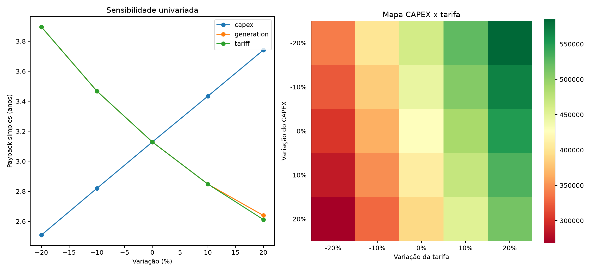
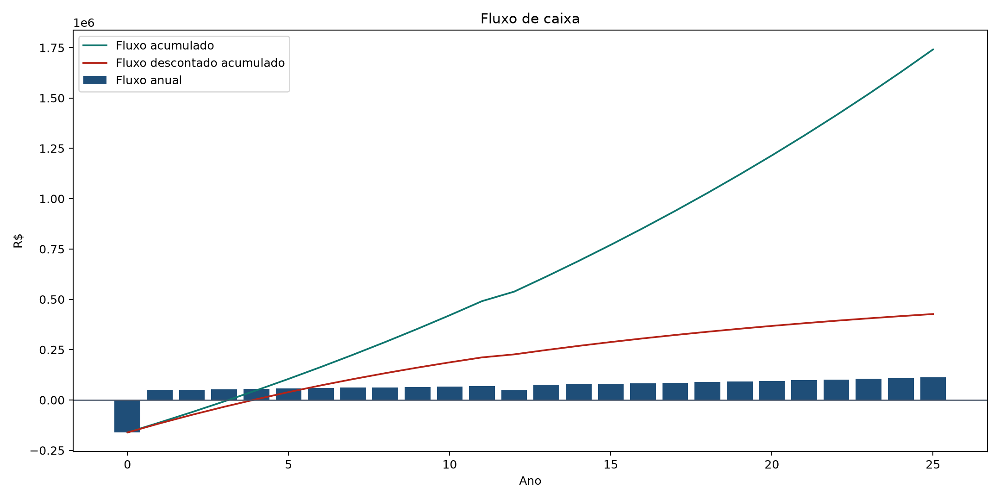

# Simulador de Viabilidade Técnica e Econômica de Energia Solar

Projeto de portfólio que integra engenharia elétrica, geração fotovoltaica, modelagem financeira, Excel, Streamlit e documentação técnica em português.

## Visão Geral

O simulador estima a potência fotovoltaica recomendada, a geração mensal/anual, o fluxo de caixa em 25 anos e indicadores de decisão para um cliente comercial fictício. Os dados são sintéticos e servem para demonstração profissional. Tarifa, reajuste tarifário, CAPEX, OPEX e fator de emissões são premissas editáveis.


## Principais Resultados do Caso-Base

| Indicador | Resultado |
| --- | ---: |
| Potência instalada | 38.4 kWp |
| Módulos | 64 |
| Geração anual estimada | 54,286 kWh |
| CAPEX | R$ 161.280 |
| Economia líquida no Ano 1 | R$ 49.636 |
| Payback simples | 3.1 anos |
| Payback descontado | 3.9 anos |
| VPL | R$ 426.941 |
| TIR | 34,1% |
| ROI acumulado em 25 anos | 1179,6% |
| LCOE | R$ 0.396/kWh |

## Como Executar

```bash
python -m pip install -r requirements.txt
python scripts/finalizar_projeto.py
python -m streamlit run app.py
```

No Windows, use `ATUALIZAR_TUDO.bat` para regenerar os artefatos e `INICIAR_SIMULADOR.bat` para abrir o Streamlit.

## Streamlit

O app possui oito abas:

1. Visão Geral
2. Dimensionamento
3. Energia e Geração
4. Análise Financeira
5. Fluxo de Caixa
6. Cenários
7. Sensibilidade
8. Premissas e Metodologia



## Excel

O arquivo `Solar_Feasibility_Simulator.xlsx` contém entradas editáveis, geração mensal, custos, fluxo de caixa, cenários, sensibilidade, mapa CAPEX x tarifa, premissas e documentação. As células de entrada ficam destacadas em amarelo.



## Metodologia

O dimensionamento usa consumo diário médio dividido por HSP e Performance Ratio. A geração mensal considera potência instalada, HSP, dias do mês, Performance Ratio e disponibilidade. A geração anual é degradada ao longo da vida útil.

O fluxo financeiro inclui CAPEX inicial, economia bruta, OPEX anual, custos extraordinários opcionais, fluxo líquido, fluxo descontado, VPL, TIR, payback simples, payback descontado, ROI acumulado e LCOE.

## Definições

ROI acumulado em 25 anos = economia líquida acumulada no horizonte / CAPEX inicial.

LCOE = valor presente de CAPEX, OPEX e custos extraordinários / energia degradada descontada.

## Premissas e Limitações

Tarifa e reajuste tarifário são premissas sintéticas de cenário, não valores oficiais e não previsões. O fator de emissões é uma premissa ilustrativa editável, não fonte oficial. Para uso técnico real, substitua essas entradas por dados regulatórios, comerciais e ambientais com data de referência.

## Estrutura

- `app.py`: app Streamlit em português.
- `src/`: modelos técnico, financeiro, cenários e sensibilidade.
- `scripts/`: execução, validação, Excel, assets e finalização.
- `outputs/`: CSV, JSON e resumo único de portfólio.
- `assets/`: gráficos, screenshots, arquitetura e imagens LinkedIn.
- `linkedin/`: textos prontos para cadastro e divulgação.
- `docs/`: documentação complementar.

## Validação

..................                                                       [100%]
18 passed in 0.22s

Model validation passed.
